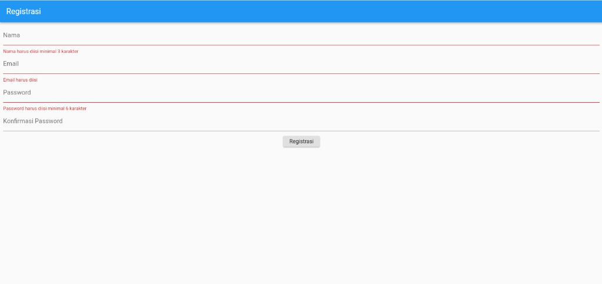
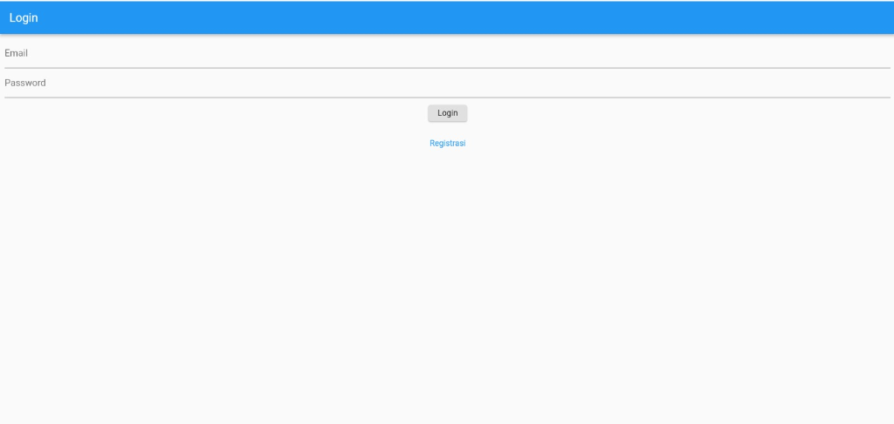
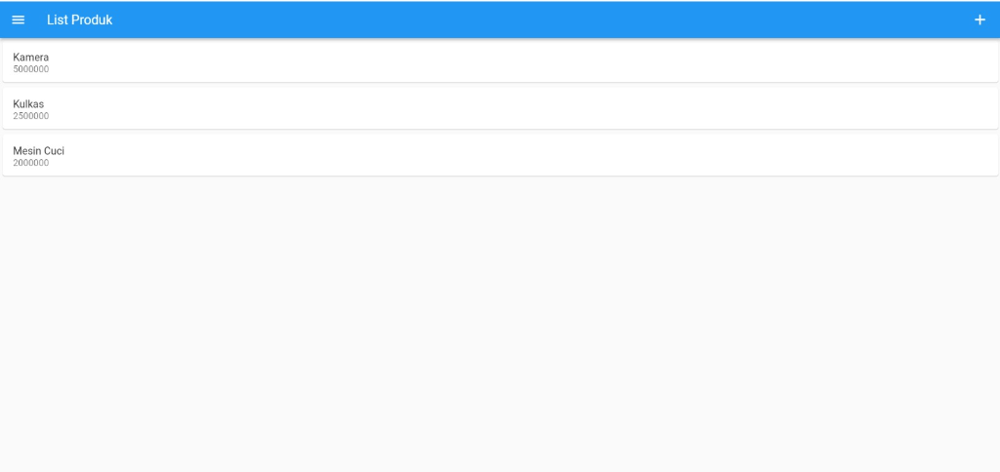
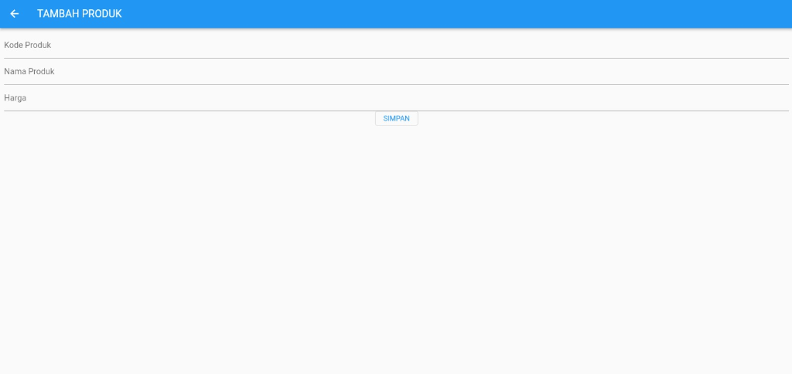
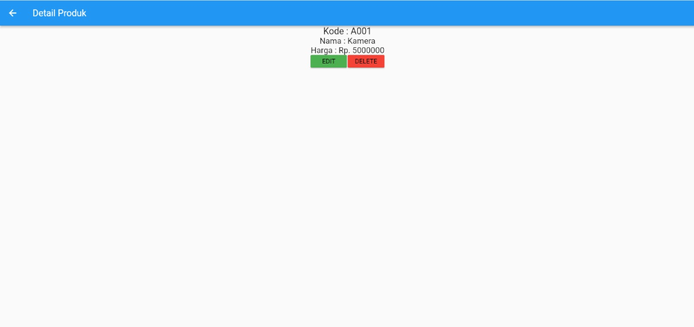
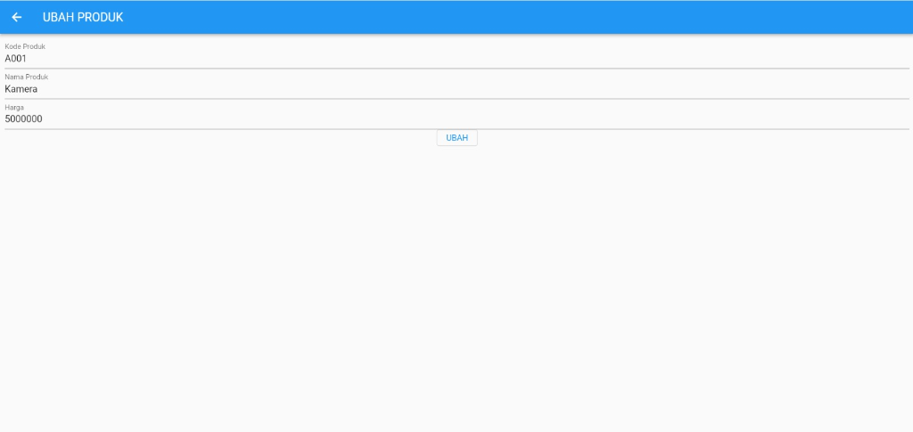
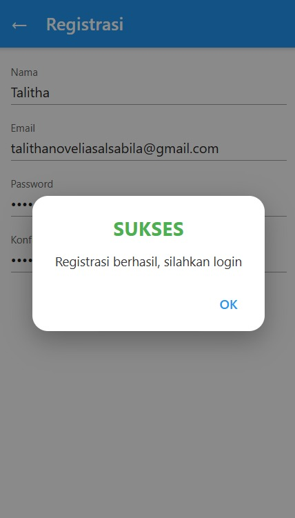
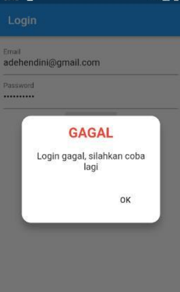
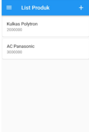

**Nama:** Talitha Novelia Salsabila  
**NIM:** H1D024122  
**Shift:** C  

## Pertemuan 1

**Materi:** Instalasi Lingkungan Flutter & Dasar Bahasa Pemrograman Dart

**Penjelasan Teknis:**
1. **Instalasi & Konfigurasi Environment:**
   - Melakukan instalasi dan konfigurasi Java Development Kit (JDK) serta Android Studio yang mencakup Android SDK, Android SDK Command-line Tools, dan Android Virtual Device (AVD).
   - Mengunduh Flutter SDK dan mendaftarkan direktori `bin` ke *System Environment Variables* (`Path`) pada sistem operasi Windows agar perintah CLI Flutter (`flutter doctor`, `flutter create`, `flutter run`) dapat dieksekusi secara global dari berbagai terminal dan IDE.
2. **Sintaksis & Paradigma Pemrograman Dart:**
   - Mempelajari dan mempraktikkan fundamental bahasa Dart melalui platform DartPad, meliputi penanganan tipe data (*statically typed* seperti `int`, `double`, `String`, `bool`, serta inferensi tipe `var`).
   - Menerapkan struktur kendali alur eksekusi program: percabangan kondisional (`if`, `else if`, `else`, `switch-case`) dan perulangan (`for`, `while`, `do-while`).
   - Mengimplementasikan modularisasi logika menggunakan fungsi (*functions*), parameter bernilai default (*default parameters*), serta parameter bernama (*named parameters*).
   - Menerapkan paradigma *Object-Oriented Programming* (OOP) meliputi pembuatan kelas (*class*), konstruktor (*constructor*), pembungkusan (*encapsulation*), serta pewarisan (*inheritance*).
   - Mengelola kesalahan runtime menggunakan blok `try-catch-finally`, serta mengeksekusi operasi asinkronus menggunakan `Future`, `async`, dan `await`.

**Penjelasan Non-Teknis:**
1. **Kesiapan Infrastruktur & Alat Kerja Pengembang:**
   - Menyiapkan seluruh perangkat lunak dan dependensi pengembangan agar lingkungan kerja siap digunakan untuk proses kompilasi aplikasi mobile lintas platform (*cross-platform*) tanpa kendala teknis dependensi.
2. **Pembentukan Pola Pikir Komputasional:**
   - Membangun logika berpikir yang terstruktur dalam menyelesaikan masalah pemrograman, mulai dari bagaimana data disimpan dan diolah hingga bagaimana kode dikelompokkan ke dalam modul-modul fungsi dan objek yang teratur.
3. **Efisiensi Pengembangan Lintas Platform:**
   - Mengenal dan memahami efisiensi framework Flutter dan bahasa Dart yang memungkinkan penulisan satu basis kode (*single codebase*) untuk menghasilkan aplikasi berkualitas tinggi pada berbagai sistem operasi target (Android dan iOS).

**Kesimpulan Pertemuan 1:**
Konfigurasi lingkungan pengembangan yang tepat serta pemahaman menyeluruh terhadap bahasa pemrograman Dart merupakan fondasi mutlak dalam pemrograman aplikasi bergerak berbasis Flutter. Praktikan memahami bagaimana mengintegrasikan dependensi sistem (JDK, Android SDK, Flutter SDK) hingga siap digunakan untuk kompilasi lintas platform (*cross-platform*). Selain itu, sintaks Dart yang berbasis OOP dan mendukung eksekusi asinkronus (*async-await*) memberikan efisiensi tinggi bagi developer dalam membangun logika aplikasi yang kokoh, terstruktur, dan berkinerja optimal sebelum melangkah ke perancangan antarmuka visual (UI).

---

## Pertemuan 2

| Hello World | Widget Column | List Data Produk |
| :---: | :---: | :---: |
|  |  |  |

**Materi:** Pengenalan dan Desain Framework Flutter (Stateless & Stateful Widget, Column, ListView)

**Penjelasan Teknis:**
1. **Hello World (`hello_world.dart`):**
   - Mengimplementasikan struktur dasar antarmuka Flutter menggunakan `StatelessWidget` yang bersifat statis (tidak mengalami perubahan state selama siklus hidup widget).
   - Memanfaatkan kerangka visual `Scaffold` yang menyediakan struktur standar Material Design, termasuk `AppBar` bertuliskan *"Belajar Flutter"* serta widget `Center` yang memposisikan teks `Text("Hello World")` tepat di tengah area layar secara modular.
2. **Widget Column (`column_widget.dart`):**
   - Menerapkan widget tata letak multi-anak `Column` untuk menyusun sekumpulan widget turunan secara vertikal pada sumbu utama (*main axis / Y-axis*).
   - Menata elemen teks bertingkat (*Kolom 1*, *Kolom 2*, *Kolom 3*, *Kolom 4*) secara menurun dari atas ke bawah dengan pengelolaan perataan default yang rapi.
3. **List Data Produk (`produk_page.dart`):**
   - Mengimplementasikan komponen dinamis berbasis `StatefulWidget` untuk mendukung pembaruan status dan pengelolaan data pada antarmuka pengguna.
   - Menggunakan widget `ListView` yang memberikan kemampuan gulir vertikal (*scrollable*) pada koleksi data yang melampaui resolusi layar.
   - Membungkus setiap item data produk (*Kulkas*, *Playstation*, *Radio*) menggunakan kombinasi `Card` dan `ListTile` untuk memberikan efek elevasi bayangan, batas tepi kartu yang rapi, serta penempatan informasi judul nama produk (`title`) dan rincian harga (`subtitle`).

**Penjelasan Non-Teknis:**
1. **Hierarki Antarmuka yang Teratur & Intuitif:**
   - Memudahkan pengguna akhir dalam membaca dan mencerna informasi aplikasi karena tata letak visual disajikan secara runtut, tidak bertumpuk, dan proporsional.
2. **Penyajian Data yang Menarik & Rapi (User Experience):**
   - Penggunaan komponen kartu (*Card*) pada daftar produk memberikan batas visual yang jelas antar produk, menciptakan kesan tampilan katalog yang profesional dan nyaman dilihat.
3. **Modularitas & Kemudahan Pemeliharaan Kode:**
   - Pendekatan arsitektur berbasis widget (*Everything is a Widget*) memudahkan pengembang dalam memodifikasi atau memperluas bagian antarmuka tertentu secara terisolasi tanpa merusak komponen antarmuka lainnya.

**Kesimpulan Pertemuan 2:**
Pengenalan dan Desain Framework Flutter memberikan pemahaman fundamental mengenai perancangan antarmuka aplikasi bergerak berbasis pohon widget (*Everything is a Widget*). Praktikan mempelajari perbedaan esensial antara `StatelessWidget` yang bersifat statis dan `StatefulWidget` yang mendukung pembaruan status internal secara dinamis. Selain itu, penguasaan komponen tata letak dasar seperti `Column` untuk pengaturan posisi vertikal serta `ListView` untuk penyajian data kolektif dalam format kartu (*Card*) menjadi fondasi penting dalam membangun antarmuka aplikasi mobile yang modular, responsif, dan mudah dipelihara.

---

## Pertemuan 3

| Login Page | Home Page | Sidemenu |
| :---: | :---: | :---: |
|  |  |  |

**Materi:** Routes, Side Menu, Login, dan Local Storage (Shared Preferences)

**Penjelasan Teknis:**
1. **Form Autentikasi Pengguna (`login_page.dart`):**
   - Mengimplementasikan antarmuka input formulir menggunakan widget `TextField` untuk username dan password, dilengkapi parameter `obscureText: true` pada kolom kata sandi untuk menyamarkan karakter input demi keamanan visual.
   - Menautkan tombol aksi `ElevatedButton` ("Login") untuk memeriksa validasi kredensial pengguna. Jika kredensial yang dimasukkan valid (`admin`/`admin`), aplikasi menyimpan nilai username ke penyimpanan lokal perangkat (*local storage*) melalui fungsi `setString` dari package `shared_preferences`.
   - Mengintegrasikan dialog umpan balik interaktif menggunakan `AlertDialog` untuk memberikan informasi keberhasilan maupun kegagalan proses login sebelum pengguna diarahkan ke rute halaman berikutnya.
2. **Halaman Beranda & Pengelolaan Sesi (`home_page.dart`):**
   - Mengambil kembali nilai sesi username yang tersimpan di *local storage* secara asinkronus menggunakan method `getString` dari `SharedPreferences` pada fungsi `_loadUsername()`.
   - Mengaitkan nilai sesi tersebut ke dalam variabel status internal (`_namauser`) menggunakan fungsi `setState` agar informasi pengguna langsung dirender secara dinamis di tengah layar (*"Ini adalah halaman User $namauser"*).
   - Menghubungkan menu navigasi samping melalui properti `drawer` pada `Scaffold`.
3. **Menu Navigasi Geser / Navigation Drawer (`sidemenu.dart`):**
   - Mengimplementasikan komponen `Drawer` yang menampung `DrawerHeader` sebagai area identitas menu navigasi samping.
   - Memanfaatkan widget `ListTile` yang dilengkapi properti `leading` untuk ikon menu (`Icons.home` untuk Home dan `Icons.info` untuk About) serta `title` untuk label navigasi.
   - Menerapkan mekanisme perpindahan halaman berbasis tumpukan (*navigation stack*) menggunakan `Navigator.push` dan `MaterialPageRoute` untuk transisi navigasi antar halaman secara terstruktur.

**Penjelasan Non-Teknis:**
1. **Keamanan & Pembatasan Hak Akses:**
   - Memberikan mekanisme perlindungan privasi dan keamanan data dengan mewajibkan autentikasi pengguna sebelum dapat mengakses konten utama aplikasi.
2. **Personalisasi Pengalaman Pengguna (Personalized Experience):**
   - Menampilkan identitas pengguna yang sedang login pada halaman utama memberikan rasa kejelasan status akun dan meningkatkan kenyamanan interaksi pengguna.
3. **Efisiensi Navigasi Aplikasi:**
   - Penggunaan laci navigasi samping (*Sidemenu/Drawer*) menghemat ruang visual layar ponsel cerdas dan mempermudah pengguna untuk beralih antar halaman aplikasi secara intuitif tanpa membebani tampilan utama.

**Kesimpulan Pertemuan 3:**
Praktikum Modul 3 mengenai Routes, Side Menu, Login, dan Local Storage memberikan pemahaman komprehensif mengenai pengelolaan alur navigasi multi-halaman dan manajemen sesi data pengguna pada framework Flutter. Praktikan berhasil menerapkan sistem autentikasi sederhana berbasis dialog alert serta memanfaatkan package `shared_preferences` untuk menyimpan dan membaca data sesi secara asinkronus ke penyimpanan lokal (*local storage*). Selain itu, penerapan navigasi *routing* berbasis `MaterialPageRoute` yang dipadukan dengan komponen antarmuka `Drawer` (*Sidemenu*) menjadi fondasi esensial dalam membangun arsitektur aplikasi mobile yang memiliki hierarki navigasi rapi, terorganisir, dan berorientasi pada kenyamanan pengguna (*user-friendly*).

---

## Pertemuan 4

| Form Registrasi (Validasi) | Form Login | List Produk |
| :---: | :---: | :---: |
|  |  |  |

| Form Tambah Produk | Detail Produk | Form Ubah Produk |
| :---: | :---: | :---: |
|  |  |  |

**Materi:** Operasi CRUD dengan API CodeIgniter 4 (Bagian 1: Desain Model Data, Form CRUD Flutter, dan RESTful API Backend)

**Penjelasan Teknis:**
1. **Pemodelan Data Berorientasi Objek (Data Modeling):**
   - Merancang model data terstruktur pada sisi aplikasi Flutter (`lib/model/login.dart`, `lib/model/registrasi.dart`, dan `lib/model/produk.dart`) yang merepresentasikan entitas akun, sesi login, dan produk.
   - Mengimplementasikan *factory constructor* `fromJson` dan method `toJson` untuk konversi otomatis antara format JSON standar RESTful API dan objek Dart yang bersifat *type-safe*.
2. **Validasi Formulir Client-Side yang Terstruktur:**
   - Memanfaatkan komponen `Form` dan `GlobalKey<FormState>` pada `registrasi_page.dart` dan `login_page.dart` untuk validasi data input pengguna secara seketika (*real-time*).
   - Menerapkan aturan validasi ketat: nama minimal 3 karakter, format alamat email yang valid menggunakan ekspresi reguler (*Regular Expression* `RegExp(r'^[\w-\.]+@([\w-]+\.)+[\w-]{2,4}$')`), password minimal 6 karakter, serta verifikasi kesesuaian nilai antara kolom password dan konfirmasi password.
3. **Komponen Antarmuka CRUD Modular:**
   - **Katalog Produk (`produk_page.dart`):** Menampilkan daftar produk dinamis menggunakan `ListView.builder` dan komponen `Card`/`ListTile`, tombol pintas tambah data (`+`) pada `AppBar`, serta navigasi `Drawer` yang memuat tautan menu Registrasi, Login, dan Logout.
   - **Formulir Produk Multifungsi (`produk_form.dart`):** Form dinamis yang dapat menangani dua operasi sekaligus (penambahan produk baru dan pembaruan produk yang sudah ada). Form mendeteksi parameter objek `Produk` yang dikirimkan: jika bernilai `null`, halaman beroperasi sebagai form tambah (*"TAMBAH PRODUK"*); jika objek berisi data produk lama, kolom input otomatis terisi dan tombol aksi berubah menjadi *"UBAH"*.
   - **Rincian Produk & Dialog Konfirmasi Hapus (`produk_detail.dart`):** Menampilkan rincian data produk (kode produk, nama produk, dan nominal harga). Dilengkapi tombol aksi `EDIT` berwarna hijau untuk mengarahkan pengguna ke form pembaruan data, serta tombol `DELETE` berwarna merah yang memunculkan dialog konfirmasi `AlertDialog` ("Yakin ingin menghapus data ini?") sebelum eksekusi penghapusan data dilakukan.
4. **Arsitektur RESTful API Backend (CodeIgniter 4 & MySQL):**
   - Membangun backend RESTful API pada direktori `toko-api` menggunakan framework CodeIgniter 4 yang terhubung ke basis data MySQL `toko_api` yang memuat tabel `member`, `member_token`, dan `produk`.
   - Mengimplementasikan *controller* turunan `ResourceController` (`RegistrasiController`, `LoginController`, `ProdukController`) dengan pengembalian format JSON terstandarisasi (`code`, `status`, `data`).
   - Menyediakan 7 rute endpoint RESTful API:
     - `POST /registrasi` : Mendaftarkan akun member baru dengan enkripsi keamanan password `password_hash()`.
     - `POST /login` : Mengotentikasi kredensial pengguna dan menerbitkan token otorisasi unik (*auth token*).
     - `POST /produk` : Menambahkan entri data produk baru ke dalam tabel basis data.
     - `GET /produk` : Mengambil seluruh koleksi data produk untuk ditampilkan pada antarmuka aplikasi.
     - `GET /produk/{id}` : Mengambil satu data spesifik produk berdasarkan identifier unik (*primary key*).
     - `PUT /produk/{id}` : Memperbarui data produk yang ada di basis data berdasarkan identifier ID.
     - `DELETE /produk/{id}` : Menghapus data produk dari basis data berdasarkan identifier ID.

**Penjelasan Non-Teknis:**
1. **Pencegahan Human Error & Akurasi Masukan:**
   - Validasi formulir di sisi aplikasi (*client-side*) langsung memberikan peringatan visual yang jelas saat input pengguna tidak valid, mencegah pengiriman data yang salah atau kosong ke server basis data.
2. **Kenyamanan & Keamanan Antarmuka Pengguna (User Experience):**
   - Penerapan pembedaan warna visual yang intuitif pada tombol aksi (warna hijau untuk ubah data dan merah untuk hapus data) serta penyediaan dialog konfirmasi sebelum penghapusan data memberikan perlindungan kepada pengguna agar tidak melakukan tindakan yang tidak disengaja.
3. **Integrasi Client-Server & Skalabilitas Aplikasi:**
   - Pemisahan antarmuka mobile (Flutter) dan logika pengolahan data terpusat (RESTful API CodeIgniter 4 & MySQL) memastikan data katalog dan transaksi tersimpan secara aman, konsisten, dan dapat diakses bersama secara real-time oleh banyak pengguna.

**Kesimpulan Pertemuan 4:**
Praktikum Modul 4 mengenai Operasi CRUD dengan API CodeIgniter 4 Bagian 1 berhasil mengintegrasikan pemodelan data berorientasi objek di sisi Flutter dengan perancangan antarmuka CRUD yang lengkap, aman, dan modular. Penerapan validasi form client-side memastikan integritas data masukan sebelum diproses lebih lanjut, sedangkan rancangan halaman katalog (`ProdukPage`), form multifungsi (`ProdukForm`), dan rincian produk (`ProdukDetail`) menghadirkan alur kerja manajemen data yang intuitif bagi pengguna. Selain itu, perancangan RESTful API backend berbasis CodeIgniter 4 dan MySQL menjadi fondasi krusial dalam menghubungkan antarmuka mobile dengan basis data terpusat, memastikan seluruh siklus Create, Read, Update, dan Delete data dapat berjalan secara konsisten, aman, dan terstandarisasi.

---

## Pertemuan 5

| Registrasi Berhasil (Success Dialog) | Login Gagal (Warning Dialog) | List Data Produk (REST API) |
| :---: | :---: | :---: |
|  |  |  |

**Materi:** Operasi CRUD dengan API CodeIgniter 4 (Bagian 2: Helper, BLoC, Widget Dialog, dan Integrasi Full-Stack REST API ke Flutter)

**Penjelasan Teknis:**
1. **Konfigurasi Dependensi & Arsitektur Lapisan Helper:**
   - Menambahkan dependensi paket `http` untuk protokol pengiriman request RESTful API dan `shared_preferences` untuk persistensi sesi lokal di `pubspec.yaml`.
   - Mengimplementasikan modul `user_info.dart` untuk mengelola penyimpanan token autentikasi (`setToken`, `getToken`) dan `userID` secara persisten, serta fungsi `logout()` menggunakan `pref.clear()`.
   - Merancang kelas penanganan error khusus pada `app_exception.dart` (`FetchDataException`, `BadRequestException`, `UnauthorisedException`, `InvalidInputException`) untuk menangani kegagalan jaringan atau kode status HTTP tertentu.
   - Membangun wrapper HTTP terpusat pada `api.dart` yang otomatis menyematkan header `Authorization: Bearer <token>` dan mem-parsing kode status respons server (200, 400, 401, 403, 422, 500).
   - Mengatur sentralisasi URL endpoint pada `api_url.dart` yang adaptif lintas platform (menggunakan `http://10.0.2.2/toko-api/public` untuk Android Emulator dan `http://localhost/toko-api/public` untuk pengujian desktop/web).
2. **Pola Desain Business Logic Component (BLoC):**
   - Menerapkan pemisahan tugas (*separation of concerns*) antara logika komunikasi data dengan antarmuka visual melalui `RegistrasiBloc` pada `registrasi_bloc.dart`, `LoginBloc` pada `login_bloc.dart`, dan `ProdukBloc` pada `produk_bloc.dart`.
   - `RegistrasiBloc.registrasi` menerima masukan parameter identitas (`nama: "Talitha"`, `email: "talithanoveliasalsabila@gmail.com"`, `password: "123456"`), membungkusnya ke dalam format JSON, mengeksekusi request `POST` via kelas `Api`, dan mengonversi respons balikan ke dalam model data `Registrasi`.
   - `LoginBloc.login` mengirimkan kredensial email dan password pengguna ke endpoint `POST /login` untuk memvalidasi otentikasi serta menerima respon token sesi unik.
   - `ProdukBloc.getProduks` mengirimkan request `GET /produk` ke server backend untuk mengambil seluruh koleksi produk aktif dan memetakan setiap objek JSON ke dalam daftar koleksi model `List<Produk>`.
3. **Komponen Reusable Dialog & Penyajian Data Dinamis:**
   - **SuccessDialog (`success_dialog.dart`):** Komponen dialog visual kustom bertema hijau dengan judul **SUKSES**, pesan *"Registrasi berhasil, silahkan login"*, dan tombol **OK** yang menutup dialog dan mengarahkan pengguna ke halaman login.
   - **WarningDialog (`warning_dialog.dart`):** Komponen dialog peringatan bertema merah dengan judul **GAGAL**, yang dipicu saat terjadi kegagalan otentikasi (*"Login gagal, silahkan coba lagi"*) ketika pengguna memasukkan kombinasi email/password yang salah atau saat terjadi kendala koneksi server.
   - **List Produk Dinamis (`produk_page.dart`):** Menggunakan widget `FutureBuilder<List<Produk>>` yang memantau alur asinkronus `ProdukBloc.getProduks()`. Jika request berhasil, data katalog produk dari basis data MySQL (seperti `Kulkas Polytron Rp 2.000.000` dan `AC Panasonic Rp 3.000.000`) langsung dirender secara dinamis menggunakan `ListView.builder` dan komponen `Card`/`ListTile` dengan kemampuan gulir yang mulus dan responsif.
4. **Sinkronisasi Backend RESTful API & Basis Data MySQL:**
   - Memproses pendaftaran akun pada endpoint `POST /registrasi` di `RegistrasiController` dengan pengamanan kata sandi berbasis `password_hash()`.
   - Memvalidasi kredensial login pada endpoint `POST /login` di `LoginController` dan menerbitkan token otorisasi ke tabel `member_token`.
   - Menyediakan data produk katalog pada endpoint `GET /produk` di `ProdukController` yang langsung terhubung ke tabel `produk` pada basis data MySQL `toko_api`.

**Penjelasan Non-Teknis:**
1. **Kejelasan Umpan Balik Pengguna (Feedback & User Usability):**
   - Penggunaan modal dialog pop-up yang kontras (hijau untuk SUKSES dan merah untuk GAGAL) memberikan kepastian visual seketika kepada pengguna mengenai status aksi yang mereka lakukan, baik saat berhasil mendaftarkan akun maupun saat mengalami kesalahan saat login.
2. **Transparansi Katalog & Pengalaman Pengguna (User Experience):**
   - Tampilan daftar produk yang terorganisir rapi dalam bentuk kartu (*Card*) memudahkan pengguna dalam menelusuri katalog barang dagangan secara intuitif, dengan nama produk yang jelas dan informasi harga yang terstruktur.
3. **Keamanan & Perlindungan Privasi Data:**
   - Penyamaran karakter input kata sandi (`obscureText: true`) pada form serta penerapan enkripsi satu arah (*one-way hashing*) pada kata sandi di server menjamin kerahasiaan akun pengguna (`talithanoveliasalsabila@gmail.com`) tetap terlindungi.
4. **Modularitas & Kemudahan Pemeliharaan Sistem:**
   - Pembagian kode program menjadi lapisan Helper, BLoC, Model, dan UI membuat alur kerja sistem menjadi sangat teratur, memudahkan pelacakan jika terjadi kendala teknis, serta meningkatkan efisiensi kerja tim pengembang dalam memperbarui fitur aplikasi di masa mendatang.

**Kesimpulan Pertemuan 5:**
Praktikum Pertemuan 5 berhasil mengimplementasikan integrasi nyata secara menyeluruh (full-stack) antara aplikasi antarmuka Flutter dengan backend RESTful API CodeIgniter 4 dan basis data MySQL. Penerapan pola arsitektur Helper dan BLoC menciptakan pemisahan tanggung jawab (*separation of concerns*) yang jelas, di mana antarmuka pengguna tetap fokus pada interaksi visual sementara komunikasi jaringan dan logika data ditangani secara terisolasi. Melalui implementasi form registrasi dan login dengan identitas akun `Talitha` (`talithanoveliasalsabila@gmail.com`), sistem sukses menangani berbagai skenario alur data: mulai dari registrasi akun baru dengan umpan balik `SuccessDialog`, penanganan proteksi kesalahan autentikasi dengan `WarningDialog`, hingga penarikan dan penyajian data katalog produk (`ProdukPage`) secara dinamis langsung dari basis data server, mewujudkan arsitektur aplikasi mobile modern yang tangguh, aman, dan responsif.

